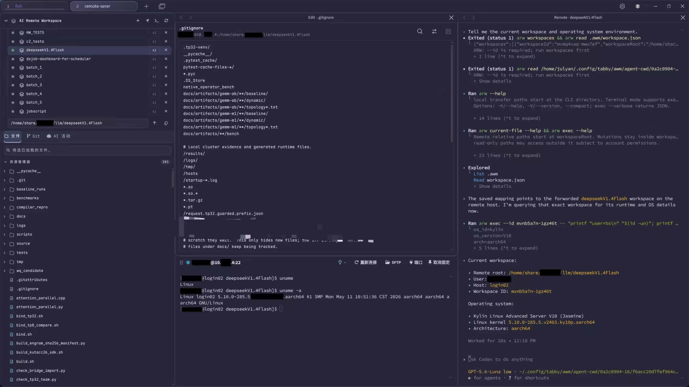

# ai-workspace-manager for Tabby

[简体中文](README.md) | [English](README.en.md)

Manage local and remote workspaces in Tabby's sidebar: browse and edit files, transfer folders, preview content, use Git, and launch local AI CLIs such as Codex or Claude to work through an existing SSH connection.

Package: `tabby-ai-workspace-manager` · CLI: `arw` · Version: `0.1.1`



## Installation

Verified with Tabby 1.0.238, Node.js 22+, npm, and Git. Install and sign in to your AI CLI separately.

1. Download `tabby-ai-workspace-manager-0.1.1.tgz` from [GitHub Releases](https://github.com/SupremeJulyan/tabby-ai-workspace-manager/releases/tag/v0.1.1).
2. Open **Settings → Plugins → Open Plugins Directory** in Tabby, then run in that directory:

   ```sh
   npm install --omit=dev --legacy-peer-deps /absolute/path/to/tabby-ai-workspace-manager-0.1.1.tgz
   ```

3. Fully quit and restart Tabby.

On Linux/macOS, installation or first plugin load creates `~/.local/bin/arw` and configures PATH for Bash, Zsh, and fish if needed, including existing Bash login profiles. On Windows, it creates `arw.cmd` in `%USERPROFILE%\.tabby-ai-workspace-manager\bin` and adds that directory to the current user's PATH when needed; no administrator or symlink privileges are required. Restart Tabby and open a new terminal to apply it. Uninstalling through Tabby removes only owned commands and PATH changes and preserves foreign commands. Before a manual command-line uninstall, run `npm run uninstall:cli` from the installed plugin directory.

## Quick start

1. Open a local terminal or connect over SSH; the sidebar shows its workspace.
2. Browse to your project and click **+** beside the workspace heading to save it.
3. Configure an AI CLI command such as `codex` or `claude` in **Tabby Settings → ai-workspace-manager**.
4. Click **AI** beside a saved workspace to launch an AI terminal for that project.

## Workspaces and files

- Switch between local and remote workspaces with the active terminal. Each tab remembers its directory, expanded folders, and Git view.
- **Open File Layout** and **AI Terminal Layout** each offer **Tiled** and **Stacked**. Stacked keeps the same placement as tiled but shows one pane from each group through previous/next arrows; all editors and terminal sessions remain active. Layout choices apply to newly opened files and AI terminals. Four percentage fields control workspace/AI widths (50/50 by default) and file/main-terminal heights (60/40). Each pair stays complementary and totals 100%; saved proportions apply when opening or rearranging panes.
- Click a folder arrow to expand it; double-click a folder to enter it. The path field supports completion, and the locate button follows the terminal's current directory.
- Resize the sidebar by dragging its edge. Fonts and colors follow Tabby settings.
- Drop local files or folders on a remote folder to upload there, or on empty space to upload to the current directory. Right-click remote items to download. Transfers require SFTP and do not silently overwrite existing targets.
- Plugin operations update the file tree immediately. Local monitoring watches visible directories; remote metadata checks run every five seconds. Background checks are bounded, so refresh manually for changes in unopened subdirectories.

UTF-8 editing supports files up to 500 MiB. Remote files are read and saved in place through SFTP, preserving permissions, ACLs, and extended attributes. Remote saves compare modification time and size without hashing or rereading the contents. Sidebar access follows server permissions; workspace boundaries are enforced at the arw CLI entry. When SFTP is unavailable, the SSH fallback requires GNU `realpath`, `stat`, and standard file tools.

Markdown opens as editable source. Click Preview to render the current buffer, including unsaved edits, in the same tab; click Source to return to editing. Save conflicts ask whether to overwrite. Choosing No reloads and displays the latest file contents.

Text tabs support find and replace: `Ctrl/Cmd+F` to find, `Ctrl/Cmd+H` to replace, `F3` / `Shift+F3` to navigate, and `Esc` to close. Case-sensitive, whole-word, and regular-expression searches are supported. Searching Markdown/CSV previews switches to source; replacing opens an editor. Replacements stay in the buffer until you save. Replace All is disabled above 10000 matches.

With Tabby's tab recovery enabled, editor, preview, and Diff tabs restore without the workspace sidebar. Remote files use a file-session pool isolated by the original SSH profile, host, port, and user: authenticated connections are reused and concurrent connection requests share one handshake. A restored, not-yet-visible SSH terminal can establish a file session through Tabby's authentication flow without switching to the terminal. File contents prefer SFTP; text reads fall back to SSH shell when SFTP is unavailable. Path boundary and save-conflict checks remain enforced. Closing a waiting file cancels that view's wait without disconnecting other views. Old blank tabs without file paths must be reopened. Unsaved edits remain in local tab state and retain conflict checks.

Failed, timed-out, or disconnected remote saves retain local edits and show an unconfirmed-save marker; the remote file may contain partial content. Verify or reload the remote file before proceeding; an overwrite retry requires confirmation. Unmodified open files can refresh automatically; unsaved edits are preserved.

| Preview type | Features | Limit |
| --- | --- | --- |
| PNG, JPEG, GIF, WebP, BMP, SVG, ICO, AVIF, TIFF | Zoom, fit, browse images in the same folder | 32 MiB; TIFF first frame, up to 16 million pixels |
| PDF | Pages, jump, zoom, password entry | 64 MiB |
| Markdown | Render/source views, relative workspace images | 2 MiB |
| CSV / TSV | Delimiter, headers, filtering, pagination, source | 8 MiB; up to 10000 rows and 200 columns |

Remote image and PDF previews require SFTP.

## Git

Background discovery finds repositories in the current directory and its subprojects. The Git view supports:

- Changes and side-by-side or unified diffs; stage, unstage, commit, and confirmed discard.
- The latest 50 commits, upstream synchronization status, and local branch switching.
- Repository initialization and cloning a new project through local Git.
- Local fetch, fast-forward pull, and push; remote pull and push relayed through local networking and credentials, with cancellation.

Discovery is limited to **two levels, 60 directories, 10 repositories, and 5000 entries**, with at most 2000 entries per directory and a three-second deadline. Automatic Git updates run at least five seconds apart. Background commands are limited to three seconds and 256 KiB; more than 1000 changes prompts you to open a project directory and refresh. Local monitoring watches up to 32 directories without recursively watching the entire tree.

## AI terminals

Choose a local Tabby shell in Settings, then configure the AI CLI command, launch arguments, recovery arguments, and HTTP/HTTPS proxy. The AI CLI launches through that shell, so it loads the shell profile and inherits its environment. The plugin never executes the AI command directly and does not provide separate AI terminal environment variables. Enter one argument per line and reopen the AI terminal after changes.

For Codex recovery, enter `resume` and `--last`; for Claude, use `--continue`. Launch and recovery arguments are configured separately. Tabby's tab recovery can restore these sessions.

Open multiple AI terminals in one tab with automatic tiling, collapse, restore, and close controls. Titles use `local->folder` or `remote->folder`, adding parent names when needed to distinguish projects.

Local AI runs in the project directory. Remote AI runs in a local placeholder under `awm/agent-cwd`, where `AGENTS.md` directs it to use `arw`. Saved remote workspaces automatically enable forwarding. **AI Activity** shows operations, status, and errors from ARW.

Remote **terminal mode** runs `arw exec` in the original interactive terminal, inheriting its current user, directory, and exported environment. Enable it at a shell prompt. In this mode, use shell commands for files; separate file and batch operations are unavailable. After changing the terminal directory, synchronize it again and reopen the AI terminal.

## ARW CLI

```sh
arw workspaces
arw list src --id ID
arw read README.md --head 40 --id ID
arw search TODO src --id ID
arw exec --id ID -- 'git status --short'
arw upload ./local-file path --id ID
arw download -r folder ./local-folder --id ID
arw git-pull --id ID
arw git-push --path subproject --id ID
```

Find the target with `arw workspaces`, then pass `--id ID` to remote operations. One AI session can use multiple forwarded workspaces. Upload takes a local source and remote destination; download takes a remote source and local destination. No path prefixes are needed. Local relative paths start at the CLI's current directory. `git-pull` / `git-push` use the sidebar's local Git relay against the workspace root or a specified subproject, using the current branch's upstream, fast-forward pulls, and non-forced pushes.

Run `arw --help` for reading, writing, searching, exact edits, creation, deletion, moves, permissions, and batches. `--input -` reads JSON from stdin, and `--file -` reads text. Long command output can be continued using the returned `outputId`.

ARW checks remote path boundaries and blocks high-risk commands. Audit records are stored at `<Tabby config directory>/omw/audit.jsonl`. Set `TABBY_CONFIG_DIRECTORY` for a custom configuration directory.

File recovery diagnostics are stored at `<Tabby config directory>/omw/file-recovery.jsonl`. They record candidate SSH session matching, connection and read stages, and waiting state changes or a 5-second heartbeat. Passwords, private keys, and file contents are not logged; error text is redacted. Logs rotate at 1 MiB with one `.1` backup. They include remote paths, usernames, and hosts; review before sharing.

## Development and packaging

```sh
npm ci
npm run check          # Build and run all tests
npm run test:portable  # Run portable host tests after building
npm run pack:plugin    # Generate artifacts/tabby-ai-workspace-manager-0.1.1.tgz
npm run dev -- /opt/Tabby/tabby
```

Development mode uses separate userData and plugin directories. See the [architecture documentation (Chinese)](docs/architecture.md) for implementation details.

See the [performance review (Chinese)](docs/performance.md) for the optimizations, benchmark results, and reproduction commands.

CI covers Linux, macOS, and Windows with Node.js 22 and 24. Linux runs the full suite; all three hosts run native Git, path, CLI lifecycle, IPC, file recovery, search/replace, packaging, and preview tests. GNU/Linux remote-shell fixtures run on Linux only; local Windows Git is not tested through Git Bash. This matrix targets the local Tabby host, not Windows SSH servers. A configured workflow is not evidence of a successful native run until CI executes.

## License

[MIT](LICENSE)

ARW reads, directory listings, searches, and download sources may use paths outside the workspace, subject to account permissions. Writes, deletes, moves, permission changes, and upload destinations remain confined to the workspace.
