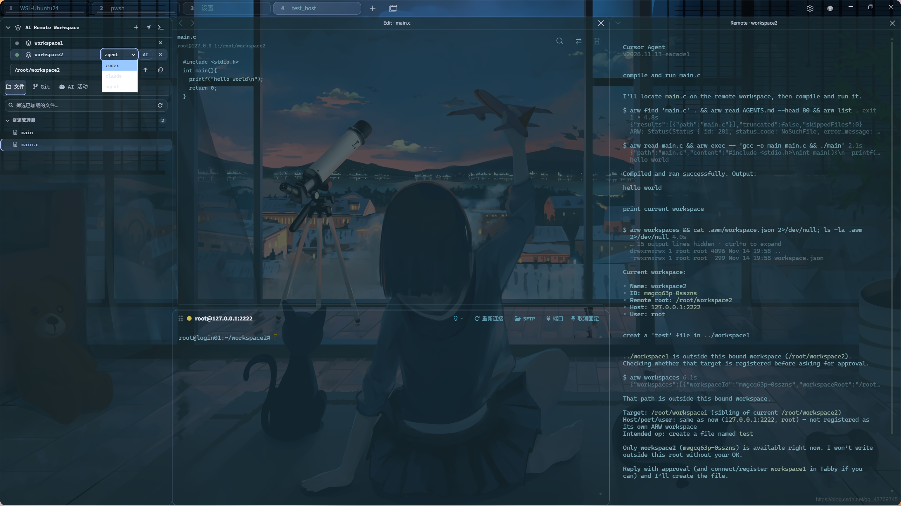

# ai-workspace-manager for Tabby

[简体中文](README.md) | [English](README.en.md)

Manage local, SSH, and WSL workspaces in Tabby with file browsing and editing, rich previews, file transfers, Git operations, and AI terminals.

Package: `tabby-ai-workspace-manager` · Version: `0.2.2`




## Installation

Verified with Tabby 1.0.238, Node.js 22+, npm, and Git. Install and sign in to your AI CLI separately.

1. Download `tabby-ai-workspace-manager-0.2.2.tgz` from [GitHub Releases](https://github.com/SupremeJulyan/tabby-ai-workspace-manager/releases/tag/v0.2.2).
2. Open **Settings → Plugins → Open Plugins Directory** in Tabby, then run in that directory:

   ```sh
   npm install --omit=dev --legacy-peer-deps /absolute/path/to/tabby-ai-workspace-manager-0.2.2.tgz
   ```

3. Fully quit and restart Tabby.

The `arw` command is available after installation. WSL AI terminals on Windows require Windows Node.js on PATH.

## Quick start

1. Open a local or WSL terminal, or connect over SSH; the sidebar shows its workspace.
2. Browse to your project and click **+** beside the workspace heading to save it.
3. Configure an AI CLI command such as `codex` or `claude` and a launch shell in **Tabby Settings → AI Workspace Manager**.
4. Click **AI** beside a saved workspace to launch an AI terminal for that project.

## Workspace management

- Manage, save, and switch between local, SSH, and WSL workspaces.
- Remember each tab's browsing directory, expanded folders, and Git view.
- Expand folders, complete paths, and locate the terminal's current directory. Selecting a saved workspace synchronizes the terminal path.
- Use native Linux paths in WSL workspaces, with the source terminal's distribution, user, and environment settings.
- Resize the sidebar, with fonts and colors following Tabby settings.

## File editing and previews

- Browse the file tree with automatic and manual refresh.
- Edit text with case-sensitive, whole-word, and regular-expression find and replace.
- Review external modification conflicts when saving, and keep local edits if a save fails.
- Drag local files or folders to upload, and right-click remote items to download. Transfers require SFTP.
- Restore editor, preview, and diff tabs, including unsaved content, with Tabby's tab recovery.

| Preview type | Features |
| --- | --- |
| PNG, JPEG, GIF, WebP, BMP, SVG, ICO, AVIF, TIFF | Zoom, fit, browse images in the same folder |
| PDF | Pages, jump, zoom, open password-protected documents |
| Markdown | Source editing, live preview, relative workspace images |
| CSV / TSV | Delimiter selection, headers, filtering, pagination, source view |

Remote image and PDF previews require SFTP.

## Layouts and small screen mode

- Choose tiled or stacked layouts separately for files and AI terminals, and adjust pane proportions.
- Switch between stacked pages while other sessions remain active.
- Enable **Small screen mode** in **Tabby Settings → AI Workspace Manager → Layout**. It takes effect immediately after saving.
- Small screen mode provides three full-area views: **sidebar and files, main terminal, and AI terminals**. Switch using the three buttons at the top while sessions keep running.

## Git

- Discover repositories in the current directory and its subprojects across local, SSH, and WSL workspaces.
- View changes and side-by-side or unified diffs; stage, unstage, commit, and confirm before discarding changes.
- View commit history and upstream synchronization status, and switch local branches.
- Initialize repositories, clone projects, fetch, fast-forward pull, and push.

## AI terminals

- Use AI CLIs such as Codex and Claude, with configurable launch shells, launch and recovery arguments, and HTTP/HTTPS proxies.
- Open multiple AI terminals in one tab, with collapse, restore, and close controls.
- Keep each AI terminal associated with its workspace when switching the sidebar.
- Continue previous sessions with Tabby's tab recovery and AI CLI recovery arguments.
- Browse and edit workspace files, search content, execute commands, and operate Git through ARW.
- View ARW operations, status, and errors in **AI Activity**, and retry forwarding after a remote connection failure.
- Use remote terminal mode to run AI commands in the current interactive terminal with its shell environment.

## ARW CLI

Use `arw` directly in a workspace's AI terminal to work with its project:

```sh
arw workspaces
arw list src
arw read README.md --head 40
arw search TODO src
arw exec -- 'git status --short'
arw upload ./local-file path
arw download -r folder ./local-folder
arw git-pull
arw git-push --path subproject
```

In other terminals, list forwarded workspaces with `arw workspaces` and select a target with `--id ID`. Run `arw --help` for file reading and writing, searching, exact edits, creation, deletion, moves, permissions, and batch operations.

## License

[MIT](LICENSE)
