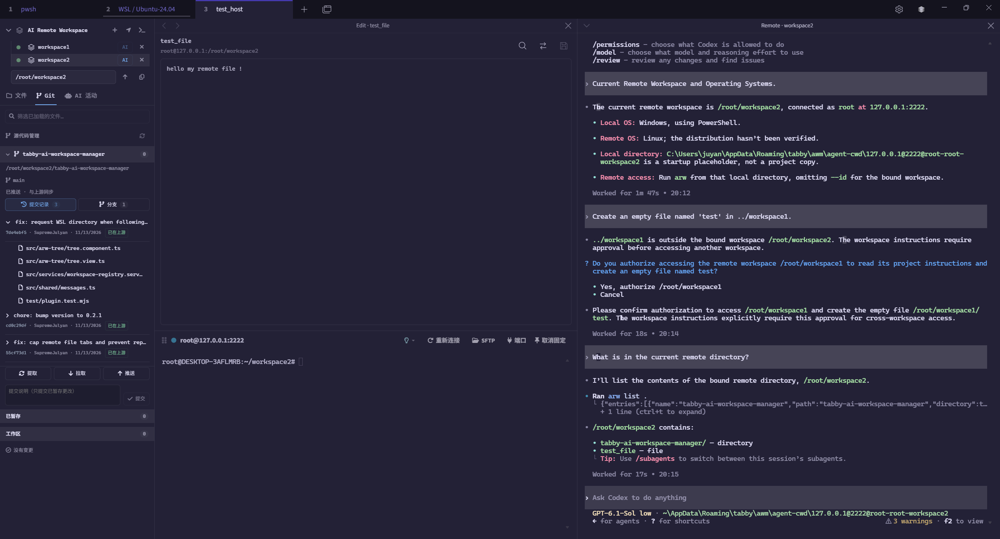

# ai-workspace-manager for Tabby

[简体中文](README.md) | [English](README.en.md)

Manage local, SSH, and WSL workspaces in Tabby with file browsing and editing, uploads and downloads, rich previews, Git operations, and AI terminal collaboration.

Package: `tabby-ai-workspace-manager` · Version: `0.1.5`



## Installation

Verified with Tabby 1.0.238, Node.js 22+, npm, and Git. Install and sign in to your AI CLI separately.

1. Download `tabby-ai-workspace-manager-0.1.5.tgz` from [GitHub Releases](https://github.com/SupremeJulyan/tabby-ai-workspace-manager/releases/tag/v0.1.5).
2. Open **Settings → Plugins → Open Plugins Directory** in Tabby, then run in that directory:

   ```sh
   npm install --omit=dev --legacy-peer-deps /absolute/path/to/tabby-ai-workspace-manager-0.1.5.tgz
   ```

3. Fully quit and restart Tabby.

The `arw` command is available after installation. WSL AI terminals on Windows require Windows Node.js on PATH. Before a manual command-line uninstall, run `npm run uninstall:cli` from the installed plugin directory.

## Quick start

1. Open a local or WSL terminal, or connect over SSH; the sidebar shows its workspace.
2. Browse to your project and click **+** beside the workspace heading to save it.
3. Configure an AI CLI command such as `codex` or `claude` and a launch shell in **Tabby Settings → ai-workspace-manager**.
4. Click **AI** beside a saved workspace to launch an AI terminal for that project.

## Workspaces and files

- Manage local, SSH, and WSL workspaces. Each tab remembers its directory, expanded folders, and Git view.
- Selecting a saved workspace synchronizes the terminal path. If synchronization fails, a message indicates pending input or unfinished work.
- Click a folder arrow to expand it; double-click a folder to enter it. The path field supports completion, and the locate button follows the terminal's current directory.
- Resize the sidebar by dragging its edge. Fonts and colors follow Tabby settings.
- Drag local files or folders to a remote directory to upload; right-click remote items to download. Existing targets are not silently overwritten. Transfers require SFTP.
- The file tree refreshes automatically and supports manual refresh.
- Edit UTF-8 files up to 500 MiB, with case-sensitive, whole-word, and regular-expression find and replace.
- Use `Ctrl/Cmd+F` to find, `Ctrl/Cmd+H` to replace, `F3` / `Shift+F3` to navigate, and `Esc` to close. Save to apply replacements; Replace All is disabled above 10000 matches.
- Save conflicts ask whether to overwrite. Failed saves preserve local edits; verify the remote file before retrying an unconfirmed save.
- With Tabby's tab recovery enabled, restore editor, preview, and Diff tabs, including unsaved edits. Remote file recovery may require authentication.

| Preview type | Features | Limit |
| --- | --- | --- |
| PNG, JPEG, GIF, WebP, BMP, SVG, ICO, AVIF, TIFF | Zoom, fit, browse images in the same folder | 32 MiB; TIFF first frame, up to 16 million pixels |
| PDF | Pages, jump, zoom, password entry | 64 MiB |
| Markdown | Source editing, preview unsaved content, relative workspace images | 2 MiB |
| CSV / TSV | Delimiter, headers, filtering, pagination, source | 8 MiB; up to 10000 rows and 200 columns |

Remote image and PDF previews require SFTP.

## WSL

- Browse, save, and restore WSL workspaces; display, copy, enter, and complete native Linux paths.
- View Git status, diffs, and history; stage, commit, initialize, clone, fetch, pull, and push in WSL workspaces.
- Launch and restore WSL AI terminals with the source terminal's distribution, user, and environment settings.
- Restore saved browser directories and manually follow the terminal's current path.

## Git

- Discover repositories in the current directory and its subprojects.
- View changes and side-by-side or unified diffs; stage, unstage, commit, and confirm before discarding changes.
- View the latest 50 commits, upstream synchronization status, and switch local branches.
- Initialize repositories or clone projects.
- Fetch, fast-forward pull, and push, including remote workspace synchronization and cancellation.

Automatic discovery checks up to two levels, 60 directories, 10 repositories, and 5000 entries. Open a specific project and refresh manually for deeper projects or large change sets.

## AI terminals

- Configure the AI CLI command, launch shell, launch and recovery arguments, and HTTP/HTTPS proxy. Enter one argument per line and reopen the AI terminal after changes.
- Open multiple AI terminals in one tab, with collapse, restore, and close controls.
- Choose tiled or stacked layouts separately for files and AI terminals, and adjust pane proportions. Switch between stacked panes while other sessions remain active.
- For Codex recovery, enter `resume` and `--last`; for Claude, use `--continue`. Continue sessions with Tabby's tab recovery.
- Each AI terminal stays associated with its workspace when you switch the sidebar.
- **AI Activity** shows operations, status, and errors from ARW.
- Use **Retry forwarding** after a remote workspace connection failure. Sent commands are not automatically replayed.
- Remote terminal mode runs AI commands in the current interactive terminal with its user, directory, and environment. Enable it at a shell prompt. After changing directories, synchronize again and reopen the AI terminal. Use shell commands for file operations in this mode.

## ARW CLI

```sh
arw workspaces
arw list src
arw read README.md --head 40
arw search TODO src
arw exec -- 'git status --short'
arw upload ./local-file path
arw download -r folder ./local-folder
arw git-pull
arw git-push --path subproject
```

Use these commands directly in terminals opened with a workspace's AI button. In other terminals, list forwarded workspaces with `arw workspaces` and select a target with `--id ID`. Missing or disconnected targets report an error without switching to another workspace.

Upload takes a local source and remote destination; download takes a remote source and local destination. Local relative paths start at the command's working directory. Git pulls are fast-forward only; pushes do not force overwrites.

Run `arw --help` for reading, writing, searching, exact edits, creation, deletion, moves, permissions, and batches. `--input -` reads JSON from stdin, and `--file -` reads text. Continue long output using its `outputId`.

Reads, directory listings, searches, and downloads may access paths allowed by the current account. Writes, deletes, moves, permission changes, and upload destinations remain confined to the workspace. Remote file compatibility features require a POSIX shell and GNU file tools.

## Development and packaging

```sh
npm ci
npm run check
npm run test:portable
npm run pack:plugin
npm run dev -- /opt/Tabby/tabby
```

## License

[MIT](LICENSE)
