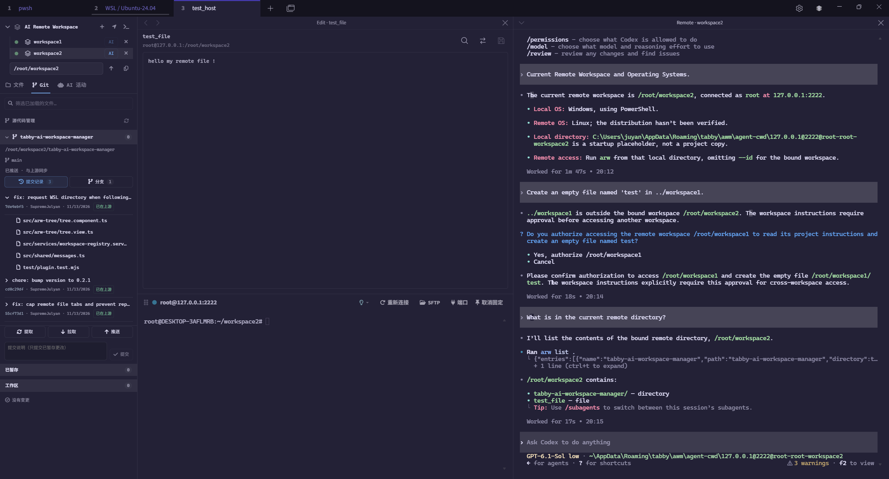

# ai-workspace-manager for Tabby

[简体中文](README.md) | [English](README.en.md)

在 Tabby 中管理本地、SSH 与 WSL 工作区，支持文件浏览与编辑、上传下载、内容预览、Git 操作和 AI 终端协作。

插件：`tabby-ai-workspace-manager` · 版本：`0.2.0`



## 安装

验证环境：Tabby 1.0.238、Node.js 22+、npm、Git。AI CLI 需另行安装并登录。

1. 从 [GitHub Releases](https://github.com/SupremeJulyan/tabby-ai-workspace-manager/releases/tag/v0.2.0) 下载 `tabby-ai-workspace-manager-0.2.0.tgz`。
2. 在 Tabby 中打开 **Settings → Plugins → Open Plugins Directory**，进入该目录执行：

   ```sh
   npm install --omit=dev --legacy-peer-deps /absolute/path/to/tabby-ai-workspace-manager-0.2.0.tgz
   ```

3. 完全退出并重新启动 Tabby。

安装后可使用 `arw` 命令。Windows 使用 WSL AI 终端时，Windows Node.js 需在 PATH 中可用。命令行手动卸载前，可在已安装插件目录运行 `npm run uninstall:cli`。

## 快速开始

1. 打开本地、WSL 终端或连接 SSH，侧栏自动显示对应工作区。
2. 浏览到项目目录，点击工作区标题旁的 **+** 保存。
3. 在 **Tabby 设置 → ai-workspace-manager** 中配置 `codex`、`claude` 等 AI CLI 命令及启动 Shell。
4. 点击已保存工作区旁的 **AI**，启动与该项目关联的 AI 终端。

## 工作区与文件

- 管理本地、SSH 与 WSL 工作区，记忆各标签页的浏览目录、展开状态和 Git 视图。
- 点击已保存工作区时同步终端路径；同步失败时显示“终端路径未同步，仍有未执行输入与任务”。
- 单击目录箭头展开，双击目录进入；路径栏支持目录补全，定位按钮读取 Tabby 原生终端目录，单次跟随；没有可靠路径时保留当前浏览位置，不注入检测脚本。
- 拖动侧栏边缘调整宽度，字体与颜色跟随 Tabby 设置。
- 将本机文件或目录拖到远程目录上传，右键远程文件或目录可下载；同名目标不会自动覆盖。传输需提供 SFTP。
- 文件树自动刷新，也可手动刷新查看最新变更。
- 编辑 UTF-8 文本，支持查找、替换、大小写、整词与正则匹配。支持文件上限为 500 MiB。
- `Ctrl/Cmd+F` 查找、`Ctrl/Cmd+H` 替换，`F3` / `Shift+F3` 切换匹配，`Esc` 关闭；替换后需保存才写入文件，超过 10000 项匹配时禁用全部替换。
- 保存遇到外部修改时确认是否覆盖；保存失败时保留本地编辑，显示“保存未确认”时请核对远端文件后再重试。
- 开启 Tabby 标签恢复后，可恢复编辑、预览、Diff 页面及未保存编辑；远程文件恢复时可能需要重新认证。

| 预览类型 | 功能 | 上限 |
| --- | --- | --- |
| PNG、JPEG、GIF、WebP、BMP、SVG、ICO、AVIF、TIFF | 缩放、适应窗口、切换同目录图片 | 32 MiB；TIFF 第一帧，最多 1600 万像素 |
| PDF | 翻页、跳页、缩放、密码输入 | 64 MiB |
| Markdown | 源码编辑、预览未保存内容、显示工作区相对路径图片 | 2 MiB |
| CSV / TSV | 分隔符、表头、筛选、分页、源码 | 8 MiB；最多 10000 行、200 列 |

远程图片和 PDF 预览需提供 SFTP。

## WSL

- 浏览、保存和恢复 WSL 工作区，支持 Linux 原生路径显示、复制、输入和补全。
- 在 WSL 工作区查看 Git 状态、差异与历史，暂存、提交、初始化、克隆、提取、拉取和推送。
- 启动与恢复 WSL AI 终端，沿用来源终端的发行版、用户和环境设置。
- 恢复已保存的浏览目录，支持手动跟随终端当前路径。

## Git

- 自动发现当前目录及子项目中的仓库。
- 查看变更及并排 / 统一差异，暂存、取消暂存、提交，确认后还原。
- 查看最近 50 条提交、上游同步状态，切换本地分支。
- 初始化仓库或克隆项目。
- 提取、快进拉取和推送，支持远程工作区同步与取消操作。

仓库自动发现最多检查 2 层、60 个目录、10 个仓库及 5000 个条目。变更较多或项目层级较深时，可进入具体项目后手动刷新。

## AI 终端

- 配置 AI CLI 命令、启动 Shell、启动与恢复参数，以及 HTTP/HTTPS 代理。参数每行一项，修改后重新打开 AI 终端生效。
- 同一标签页可打开多个 AI 终端，支持收起、恢复和关闭。
- 文件和 AI 终端分别支持平铺或叠放，支持调整窗格比例；叠放时可切换页面，其他会话保持运行。
- Codex 恢复参数可填 `resume`、`--last`，Claude 可填 `--continue`；配合 Tabby 标签恢复继续会话。
- AI 终端与对应工作区关联，切换侧栏不会改变已有 AI 终端的目标工作区。
- “AI 活动”显示经 ARW 执行的操作、状态与错误。
- 远程工作区连接失败时可点击“重试转发”；已发送的命令不会自动重复执行。
- 远程终端模式将 AI 指令原样发送到当前交互终端，使用 Tabby 原生输入、输出事件采集，不注入命令标记或 Shell 钩子。输出静默 1 秒后返回当前采集内容（包含命令回显和提示符），不代表命令已经结束；退出码为未知。指令沿用当前用户、目录、变量和函数；目录改变后需重新同步并打开 AI 终端。此模式下请使用 Shell 命令处理文件。

## ARW CLI

```sh
arw workspaces
arw list src
arw read README.md --head 40
arw search TODO src
arw exec -- 'git status --short'
arw upload ./local-file path
arw download -r folder ./local-folder
arw git-pull
arw git-push --path subproject
```

从工作区 AI 按钮打开的终端可直接使用上述命令。普通终端可用 `arw workspaces` 查看已开启转发的工作区，并通过 `--id ID` 指定目标。目标失效或断线时会报错，不会自动切换到其他工作区。

上传参数依次为本地来源、远程目标，下载相反。本地相对路径以命令运行目录为起点。Git 拉取仅允许快进，推送不强制覆盖。

运行 `arw --help` 查看读写、搜索、精确替换、创建、删除、移动、权限和批处理功能。`--input -` 从标准输入读取 JSON，`--file -` 读取文本；长输出可通过 `outputId` 续读。

读取、列目录、搜索和下载可访问当前账户有权限的路径；写入、删除、移动、改权限和上传目标限于工作区。远程文件兼容功能需要 POSIX Shell 和 GNU 文件工具。

## 开发与打包

```sh
npm ci
npm run check
npm run test:portable
npm run pack:plugin
npm run dev -- /opt/Tabby/tabby
```

## License

[MIT](LICENSE)
