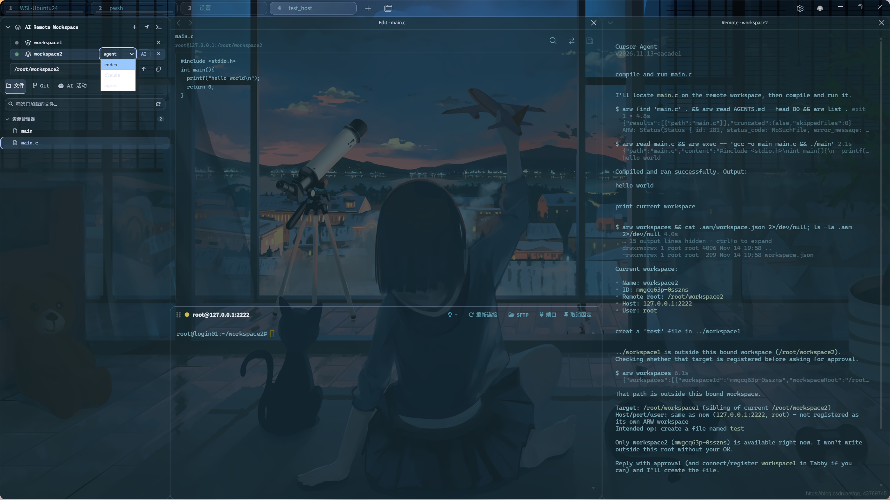
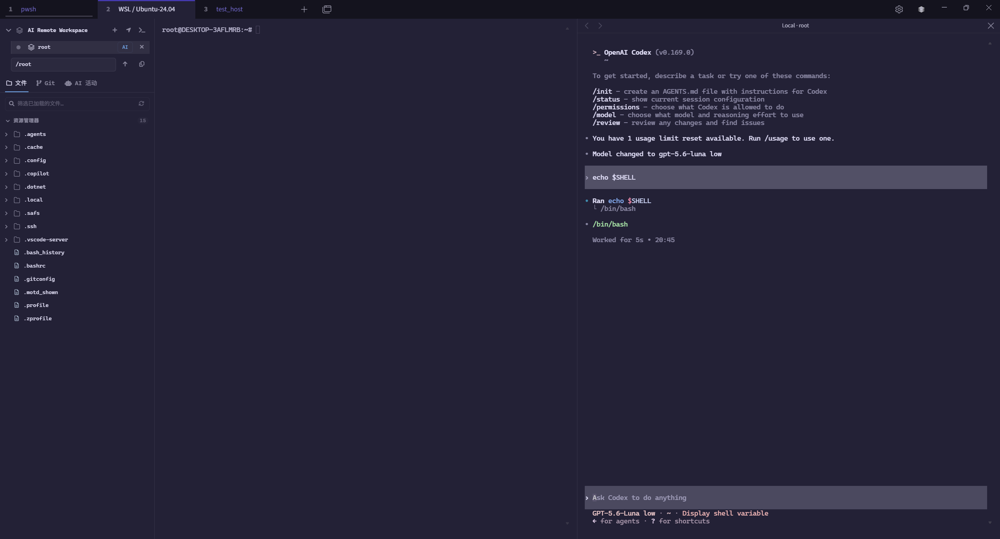

# ai-workspace-manager for Tabby

[简体中文](README.md) | [English](README.en.md)

在 Tabby 中管理本地、SSH 与 WSL 工作区，集成文件浏览与编辑、内容预览、文件传输、Git 操作和 AI 终端。

插件：`tabby-ai-workspace-manager` · 版本：`0.2.3`




## 安装

验证环境：Tabby 1.0.238、Node.js 22+、npm、Git。AI CLI 需另行安装并登录。

1. 从 [GitHub Releases](https://github.com/SupremeJulyan/tabby-ai-workspace-manager/releases/tag/v0.2.3) 下载 `tabby-ai-workspace-manager-0.2.3.tgz`。
2. 在 Tabby 中打开 **Settings → Plugins → Open Plugins Directory**，进入该目录执行：

   ```sh
   npm install --omit=dev --legacy-peer-deps /absolute/path/to/tabby-ai-workspace-manager-0.2.3.tgz
   ```

3. 完全退出并重新启动 Tabby。

安装后可使用 `arw` 命令。Windows 使用 WSL AI 终端时，Windows Node.js 需在 PATH 中可用。

## 快速开始

1. 打开本地、WSL 终端或连接 SSH，侧栏自动显示对应工作区。
2. 浏览到项目目录，点击工作区标题旁的 **+** 保存。
3. 默认提供 Codex 和 Claude，启动与恢复命令都带对应的最高权限参数；首项为工作区默认 AI。在 **Tabby 设置 → AI Workspace Manager** 可选择所有 AI 共用的启动 Shell、修改或添加 AI。每条 AI 配置包含启动命令、恢复命令和代理；命令可使用 PATH 名称或完整路径及参数。旧版自定义 AI 配置会保留为首项。
4. 选中已保存工作区后，可为其选择 AI；未单独选择时使用首项默认 AI。显式选择会随工作区保存。点击该工作区的 **AI** 按钮启动。

## 工作区管理

- 管理、保存和切换本地、SSH 与 WSL 工作区。
- 记忆各标签页的浏览目录、展开状态和 Git 视图。
- 支持目录展开、路径补全和定位终端当前目录。首次点击已保存工作区会打开专属终端，再次点击会切回已有会话。
- WSL 工作区支持 Linux 原生路径，并沿用来源终端的发行版、用户和环境设置。
- 侧栏宽度可调整，字体与颜色跟随 Tabby 设置。

## 文件编辑与预览

- 浏览文件树，自动或手动刷新目录。
- 编辑文本，支持查找、替换、大小写、整词与正则匹配。
- 保存时提示外部修改冲突，保存失败保留本地编辑。
- 拖拽本机文件或目录上传，右键远程文件或目录下载；传输需要 SFTP。
- 配合 Tabby 标签恢复，恢复编辑、预览、差异页面及未保存内容。

| 预览类型 | 功能 |
| --- | --- |
| PNG、JPEG、GIF、WebP、BMP、SVG、ICO、AVIF、TIFF | 缩放、适应窗口、切换同目录图片 |
| PDF | 翻页、跳页、缩放、打开加密文档 |
| Markdown | 源码编辑、实时预览、显示工作区相对路径图片 |
| CSV / TSV | 分隔符选择、表头、筛选、分页、源码查看 |

远程图片和 PDF 预览需要 SFTP。

## 布局与小屏模式

- 文件和 AI 终端分别支持平铺或叠放，可调整窗格比例。
- 叠放布局可切换页面，其他会话保持运行。
- 在 **Tabby 设置 → AI Workspace Manager → 布局** 中开启 **小屏模式**，保存后立即生效。
- 小屏模式将内容分为 **侧栏与文件、主终端、AI 终端** 三层，每层占满内容区，通过顶部三个按钮切换，切换时会话保持运行。

## Git

- 自动发现当前目录及子项目中的仓库，支持本地、SSH 与 WSL 工作区。
- 查看变更及并排或统一差异，暂存、取消暂存、提交和确认还原。
- 查看提交历史、上游同步状态，切换本地分支。
- 初始化仓库、克隆项目、提取、快进拉取和推送。

## AI 终端

- 支持配置多条 AI 启动命令、恢复命令和 HTTP/HTTPS 代理；AI 名称从二进制文件名解析，且每个工作区单独记住所选 AI。
- 最多同时打开 9 个 AI 终端，支持在同一标签页内收起、恢复和关闭。
- 每个 AI 终端绑定对应工作区，切换侧栏不影响已有会话。
- 配合 Tabby 标签恢复和 AI CLI 恢复参数，继续之前的会话。
- 通过 ARW 浏览与修改工作区文件、搜索内容、执行命令和操作 Git。
- “AI 活动”展示 ARW 操作、状态与错误，远程连接失败后支持重试转发。
- 远程终端模式支持在当前交互终端中执行 AI 指令，沿用当前 Shell 环境。

## ARW CLI

在工作区 AI 终端中，可直接使用 `arw` 操作对应项目：

```sh
arw workspaces
arw list src
arw read README.md --head 40
arw search TODO src
printf '%s' 'git status --short' | arw exec
arw upload ./local-file path
arw download -r folder ./local-folder
arw git-pull
arw git-push --path subproject
```

普通终端可通过 `arw workspaces` 查看已开启转发的工作区，并用 `--id ID` 指定目标。运行 `arw --help` 查看文件读写、搜索、精确替换、创建、删除、移动、权限和批处理等功能。

## License

[MIT](LICENSE)
